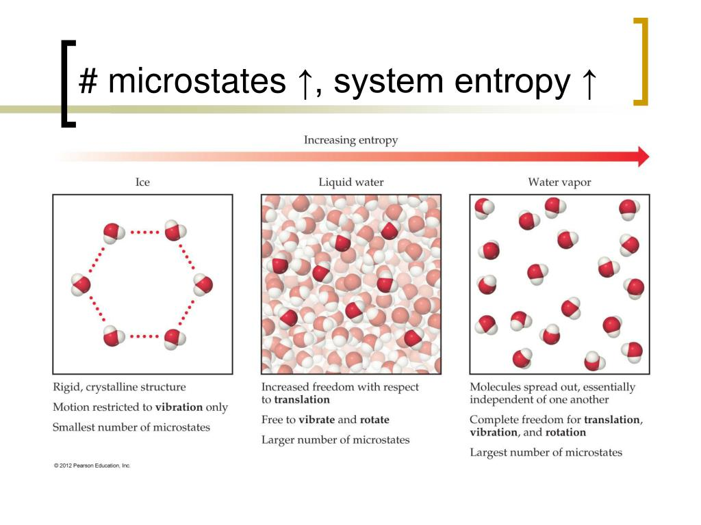
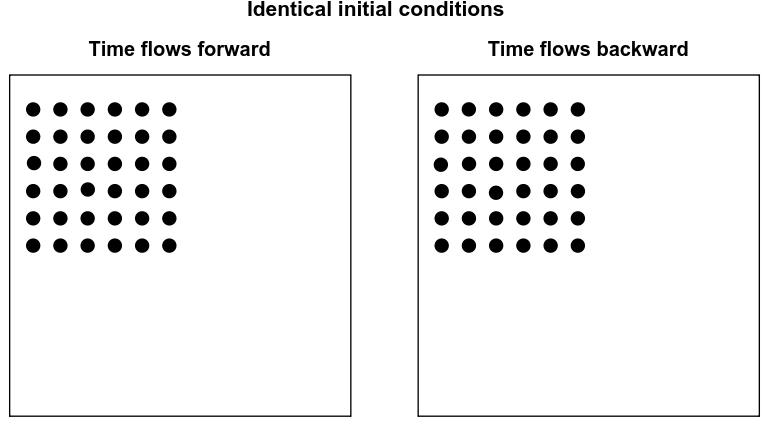

# The Arrow in the Coffee Cup: How Entropy Gives Time Its Direction

**Abdullah Shaker Abdullah · STEM 6-October for Boys**  
**Rank 1 · Thermodynamics · Gold**

The Arrow in the Coffee Cup  |  Entropy connects microscopic possibility with the direction of time, from cooling coffee to the organization of life.

Entropy is usually called “disorder.” The truth is stranger: it counts possibilities, it gives time its direction, and it may be the reason life exists at all.

The word "entropy" is often defined as a measure of disorder. It refers to the random changes that happen around us every moment. We can use it to describe the room becoming messy, a building slowly falling apart, and grains of sand carried on the wings of the wind forming a hill. Generally, entropy is often described as a loss of order in a system; however, it has a deeper meaning. It doesn't simply tell us how messy the system is or what the mess looks like. Instead, entropy helps us fathom how energy and matter are distributed within the system. In addition, it solves a conundrum of why certain changes happen naturally without any human involvement. To understand it, we must begin by looking more closely at the microscopic world, although we will observe that every physical system is made of an enormous number of particles that are constantly moving in the microscopic environment of the system, described by many properties, such as temperature and volume in addition to pressure. These properties cannot precisely describe how the particles move or their specific locations. Instead, the same macroscopic state can be produced by an enormous number of different microscopic arrangements, which are called microstates. This is where the entropy begins to reveal its deeper meaning. The question is no longer simply whether the system is ordered or disordered; the real inquiry is how many different ways that state can exist. The answer is captured by a famous relation

$$S = k_B \ln(\Omega)$$

Equation 1. Boltzmann’s entropy relation.

Here, S is the entropy, k_B is Boltzmann’s constant (about 1.38 × 10⁻²³ joules per kelvin), and Ω (omega) is the number of possible microstates of the system.

The equation reveals an idea: entropy is closely tied to possibility. The greater the number of ways in which the system can exist, the greater the entropy, as shown in Figure 1.

 For more insight, what appears to us as random disorder is something deeper: a vast number of possibilities behind a single observed state, "microstates." But if the natural world has so many paths, why does it always choose one direction? Whatever this 

direction leads to, it leads to greater entropy.

Why Does Entropy Increase

Imagine that you arranged a group of cards in a specific order. Throw it into the air; you can shuffle it for years and never see that specific order again. It's not because the cards tend to become messy; nevertheless, it's because there are far more ways to be messy than to be neat: they have more than 8 × 1067 different orders. Entropy works in the same way. Imagine you open a bottle of perfume in the corner of the room. The perfume begins concentrated in one corner, then spreads evenly throughout the room until it can be detected everywhere. Nothing directs the perfume molecules where to go. They move, collide, and spread in a lot of directions. However, there is a deeper meaning: the molecules can remain concentrated in a limited area, but there are an enormous number of combinations in which they are spread around the room; the spread-out state can exist in a huge number of microscopic pathways, whereas the concentrated state can exist in considerably fewer. Entropy doesn't mean that natural systems want disorder. But it demonstrates a statistical principle: when there are more possible ways for something to happen, the outcome becomes far more likely. Entropy therefore does not act as a force pushing the molecules toward disorder; instead, the high-entropy state is overwhelmingly more probable because it corresponds to a vastly greater number of microstates.

We can see the same idea quantitatively. Suppose N molecules can each be either in the left half or the right half of a box, with equal probability. The probability that all N molecules are found in the same half is (1/2)^N. For N = 100 molecules, this probability is about 7.9 × 10⁻³¹. The reverse of a spread-out state is therefore not impossible, but for a macroscopic number of particles it is extraordinarily unlikely.

Repeat this everywhere, and you get one of the biggest ideas in physics, which is the Second Law of Thermodynamics.

The second law of thermodynamics:

The tendency of entropy to increase isn't just a pattern we observe; it describes one of the fundamental rules of physics, the second law of thermodynamics.

$$\Delta S_{\text{universe}} \ge 0$$

Equation 2. The second law of thermodynamics.

At first, it may seem like a simple rule; however, its consequences are everywhere. A hot cup of coffee left on a table gradually cools, but a cold cup does not suddenly become hot by taking heat from the room. A drop of ink spreads through water, yet the water doesn't gather the ink back into a single drop. These events seem ordinary because we observed them numerous times. However, they reveal that natural events have a direction. A process can, in principle, be reversed, but the spontaneous reversal of the process would involve a decrease in total entropy. This is not impossible on a large scale, but it is incredibly unlikely. This is why we don't really see those processes happening.for simple heat-transfer example, suppose an amount of heat Q moves from a hot cup at T hot to a colder
room at T cold. The entropy change of the universe is

$$\Delta S_{\text{universe}} = \frac{Q}{T_{\text{cold}}} - \frac{Q}{T_{\text{hot}}}$$

Where Q is the amount of heat transferred , T is the temperature

For example, if Q = 100 J, T hot = 373 K, and T cold = 293 K, then ΔS_universe = 100/293 − 100/373 = 0.073 J/K, which is positive. The Second Law therefore turns the direction of heat flow into something that can be
calculated

The same law explains why a heat engine cannot have 100% efficiency some energy must be transferred to the surroundings as heat. It also explains why a refrigerator requires external work to move heat from a colder region
to a warmer one

By providing an arrow of time, entropy can be used to determine the direction in which a physical change takes place. Perhaps this is why entropy is so closely related to our perception of time. We differentiate between the past and the future because the world around us changes in a preferred way: coffee cools down, and ink spreads in water, making it impossible to determine whether the coffee was initially hot or cold or whether the ink was in the water from the beginning. The question here: Would entropy define the direction in which time flows?

The Arrow of Time

We are very familiar with the arrow of time. It feels natural to think that yesterday comes before today and that today comes before tomorrow. In physics, there is a more interesting question: why does time move only in one direction? Look carefully at the processes around you. A pot of coffee that was just brewed is cooling down; ice cubes are melting; drops of ink are slowly and irreversibly diffusing in a glass of water. You can always tell which of these processes came first and which came later. The reason for this one-way behaviour is that these spontaneous macroscopic processes overwhelmingly occur in the direction in which total entropy increases. So the probability of these processes occurring in the reverse direction is extremely low. This one-way behaviour of processes is called the thermodynamic arrow of time. The Arrow of Time has nothing to do with the flow of time itself. However, it is interesting that the arrow of time is not an illusion. The thermodynamic arrow of time creates the impression of time flow because restoring the system to its state after some time is practically impossible. Thus, the change in entropy is a process. Something happened to the coffee, the tea, or the ink, and the world will never be the same again. Our sense of time is closely connected to the thermodynamic arrow of time.

Entropy and Life

So yes, if entropy always tends to increase, there is another question to be asked: how can life exist at all? The living cell looks well organized; however, it builds complex structures and repairs itself, in addition to keeping its internal environment well organized. Initially, it seems to stand against the tendency of entropy to increase. Life responds here, saying that it is not in a closed system. Organisms always exchange energy and matter with their surroundings. They take in energy and use it to maintain their internal structure and release energy and heat into the environment. During this process, the entropy inside the organisms may decrease locally; at the same time, entropy is rising in their surroundings by a greater amount. Generally, life doesn't escape the Second Law of Thermodynamics; in contrast, it works within it. The law describes life brilliantly. The order we see in a living organism is not a defeat of entropy but the result of continuous energy flow through an open system. Even the most organized form of life exists not by stopping the changing, but by flowing energy through it. Figure 2 illustrates how living systems maintain local organization while entropy increases overall.

Conclusion

The candle seems to be such a simple picture of something randomly fading; now tell us a much deeper story. The flame does not disappear because nature suddenly judged it to be destroyed; rather, the conditions that support it change gradually. In the same way, the world is always moving from one state to another; the direction of movement is shaped by the law of entropy. Entropy is more than just a disorder. It describes the motion of all particles around us in addition to describing how these particles change their states every single time. It helps explain the spreading of heat and why natural processes are difficult to reverse. Perhaps this is the most essential lesson of entropy: change is not an accident in nature; it's the most descriptive part of its design. Everything changes; nothing remains. Even when the world is the most quiet drop in the sea of the universe, it is still filled with countless microscopic movements. We will not be able to stop this process; we must thank God for giving us the ability to describe and understand what life is, how time passes, and how we pass with it.

References :

Urone, P. P., & Hinrichs, R. (2020). 12.3 Second law of thermodynamics: Entropy. OpenStax.
https://openstax.org/books/physics/pages/12-3-second-law-of-thermodynamics-entropy

Urone, P. P., & Hinrichs, R. (2020). 12.4 Applications of thermodynamics: Heat engines, heat pumps, and refrigerators. OpenStax.
https://openstax.org/books/physics/pages/12-4-applications-of-thermodynamics-heat-engines-heat-pumps-and-refrigerators

Restrepo, A. (2026). Useful thermodynamic concepts from the simple coin toss experiment. The Physics Teacher, 64(2), 134–136.
https://doi.org/10.1119/5.0191131

On entropy, information, and conservation of information. (2021). Entropy, 23(7), 857.
https://pmc.ncbi.nlm.nih.gov/articles/PMC8235405/

Callender, C. (2026). Thermodynamic asymmetry in time. The Stanford Encyclopedia of Philosophy.
https://plato.stanford.edu/entries/time-thermo/

OpenStax. (2018). 6.3 The laws of thermodynamics. In Biology 2e.
https://openstax.org/books/biology-2e/pages/6-3-the-laws-of-thermodynamics

OpenStax. (2016). 4.4 Statements of the second law of thermodynamics. In University Physics Volume 2.
https://openstax.org/books/university-physics-volume-2/pages/4-4-statements-of-the-second-law-of-thermodynamics
