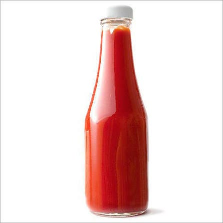
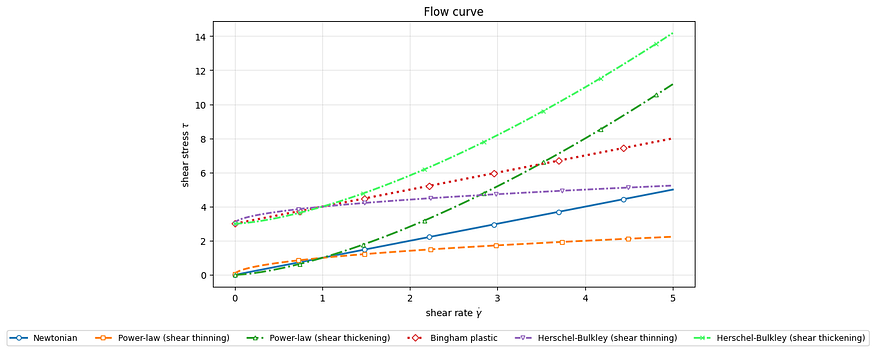
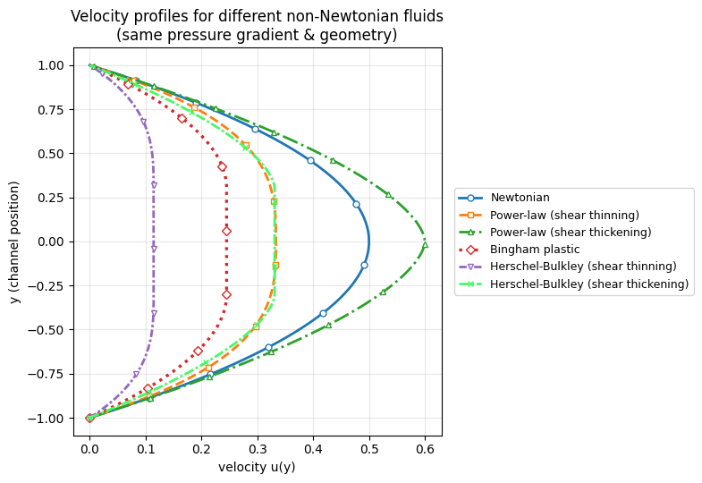

# From Ketchup to Oobleck: Non-Newtonian Fluids and Their Behavior

**Adham Mohamed Khairy · STEM High School for Boys – 6th of October**  
**Rank 2 · Fluid Mechanics · Silver**

Why do ketchup, toothpaste, and Oobleck flow so differently? Follow viscosity, shear response, and the models used to describe complex fluids.

Most of us have seen or heard about Oobleck, a mixture of water and cornstarch that is normally a liquid, but turns solid when pressure is applied to it. However, few actually think about the physics behind this fascinating phenomenon. But before diving into the physics behind non-Newtonian fluids, we have to understand what Newtonian fluids are.

Newtonian Fluids

Newtonian fluids are defined as fluids that follow Newton’s law of Viscosity:

$$\tau = \mu \dot{\gamma}$$

where 𝜏 is the shear stress, μ is the coefficient of viscosity, and 𝛾̇ is the velocity gradient or rate of shear strain (Sochi, 2015). These fluids are characterized by having constant viscosity, having a linear relationship between the shear stress and the shear rate, being time-independent, meaning that their viscosity doesn’t change with time, and having no yield stress, meaning that they don’t require initial pressure to start moving. Thus, they are predictable using only mathematical equations (Sochi, 2015).

Non-Newtonian Fluids

Non-Newtonian fluids, like Oobleck, are fluids that fall short of completing one or more of the 5 requirements of Newtonian fluids. Those fluids can’t be predicted using normal mathematical methods. Instead, they require a computational approach for analysis and prediction. However, Oobleck isn’t the only non-Newtonian fluid. In fact, we encounter more non-Newtonian fluids than Newtonian ones in our daily lives, each with different types and characteristics (Sochi, 2015).

Time-Independent Non-Newtonian Fluids

There are 3 main Types of time-independent non-Newtonian fluids: Power Law Fluids, Bingham Fluids, and Herschel-Bulkley Fluids (Sochi, 2015).

Power Law Model

Power law fluids are fluids that do not have constant viscosity. Thus, they tend to have a non-linear relationship between the shear stress and the shear rate. These fluids are analyzed using the power law model:

$$\tau = K \dot{\gamma}^{n}$$

$$\mu_{\text{app}} = K \dot{\gamma}^{n-1}$$

where K is the fluid consistency index, which measures the relative viscosity, μ is the apparent viscosity, and n is the power law index, which classifies power law fluids into two categories: Dilatant (shear-thickening) fluids, which are the most well-known type of non-Newtonian fluids, including Oobleck, where n > 1, and pseudoplastics (shear-thinning fluids), where n < 1, like ketchup in a ketchup bottle, it doesn’t flow easily when you tip it over; however, it flows smoothly when it is shaken or tapped. If n = 1, then the fluid is Newtonian (Sochi, 2015).

These everyday examples are shown in Figures 1 and 2.

Bingham Fluid

Bingham fluids are fluids that do have constant viscosity. However, they require an initial stress to start moving, called the yield stress. They are analyzed using the Bingham Model:

$$\dot{\gamma} = \begin{cases} (\tau-\tau_y)/\mu, & \tau>\tau_y \\ 0, & \tau\le\tau_y \end{cases}$$

Toothpaste illustrates this yield-stress behavior in Figure 3.

where 𝜏ᵧ is the yield stress. A notable example is toothpaste, which requires an initial stress to flow out of its container (Sochi, 2015).

Herschel-Bulkley Model

Herschel-Bulkley fluids are like a combination of power law fluids and Bingham fluids, requiring an initial stress to flow. They are modelled using the Herschel-Bulkley model:

$$\dot{\gamma} = \begin{cases} ((\tau-\tau_y)/K)^{1/n}, & \tau>\tau_y \\ 0, & \tau\le\tau_y \end{cases}$$

$$\mu_{\text{app}} = K\dot{\gamma}^{n-1}+\frac{\tau_y}{\dot{\gamma}}$$

A notable example is fresh concrete (Sochi, 2015).

The predicted flow curves are compared in Figure 4.

All of those models use the finite-difference method at interior node i to model their flow:

$$\frac{μ_{i+\frac{1}{2}}\left(u_{i+1}-u_{i}\right)-μ_{i-\frac{1}{2}}\left(u_{i}-u_{i-1}\right)}{Δy^{2}}=-G$$

This is solved using the Picard scheme, where:

Picard (fixed-point) iteration:

$$\mu_{i+\frac{1}{2}}^{(k)} = \mu\!\left(\frac{u_{i+1}^{(k)}-u_i^{(k)}}{\Delta y}\right), \qquad u_i^{(k+1)} = \text{TridiagonalSolve}(a^{(k)},b^{(k)},c^{(k)},d)$$

Tridiagonal coefficients:

$$\begin{aligned}a_i&=\frac{\mu_{i-1/2}}{\Delta y^2}, & b_i&=-\frac{\mu_{i-1/2}+\mu_{i+1/2}}{\Delta y^2},\\ c_i&=\frac{\mu_{i+1/2}}{\Delta y^2}, & d_i&=-G.\end{aligned}$$

Stopping criterion: $$\max_i \left|u_i^{(k+1)}-u_i^{(k)}\right| < \mathrm{tol}.$$

The computed pipe velocity profiles appear in Figure 5.

After computational analysis of these models in a pipe, the following graph was obtained:

Notice that the more the fluid is shear-thickening, the greater the difference between the tip and the sides (Kim & Park, 2019).

I used this notebook to make those graphs; feel free to copy it and play around with the parameters as you wish: https://colab.research.google.com/drive/1fiHbV41UAGuV0gOqVnmryRSDC5BTDbw7?usp=sharing

Time-Dependent Non-Newtonian Fluids

These are some lesser-known types of fluids. Unlike time-independent fluids, which rely on the instantaneous shear, time-dependent fluids rely on shear history, like how yogurt gets thinner the longer you stir it, or how gypsum gets thicker the more you stir it.

References

Sochi, T. (2015). Using the stress function in the flow of generalized Newtonian fluids through pipes and slits. arXiv. https://arxiv.org/abs/1503.07600

Kim, J., & Park, J. D. (2019). The non-homogeneous flow of a thixotropic fluid around a sphere. arXiv. https://arxiv.org/abs/1908.04993
