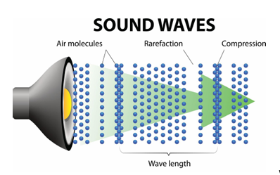
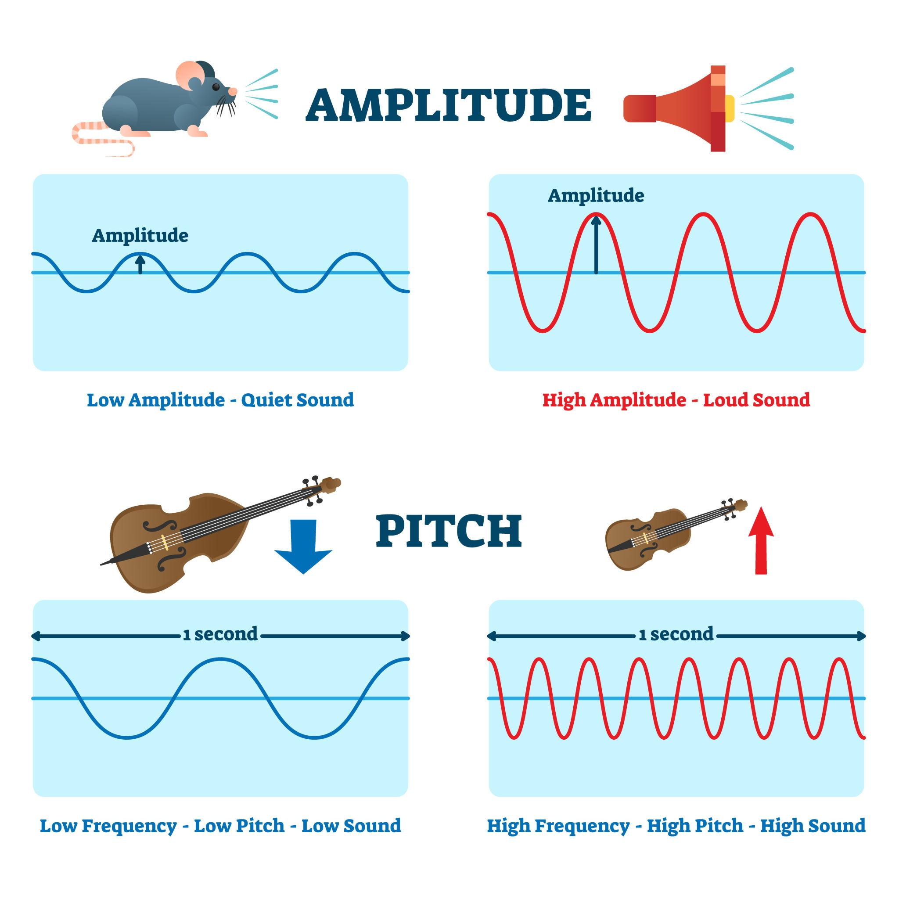
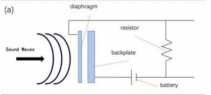
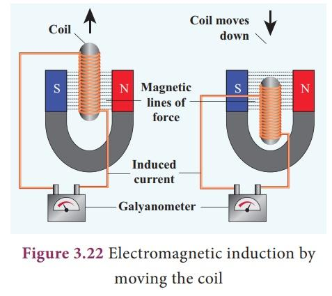
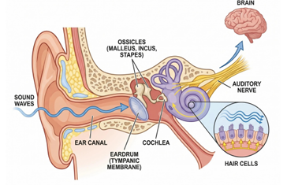

# Can Sound Become Electricity? Turning Everyday Vibrations into Energy

**Malak · Alexandria STEM School**  
**Rank 5 · Waves and Sound · Finalist**

Sound carries mechanical energy. Follow the piezoelectric and electromagnetic methods used to convert vibrations into small amounts of electricity.

Can Sound Become Electricity?

Turning Everyday Vibrations into Energy.

Have you ever wondered how we hear sounds? What is sound, actually? Does it have uses in addition to helping us hear the world around us? And can we turn it into another form of energy, such as electricity?

To answer these questions, we first need to understand what waves are.

A wave is a disturbance that transfers energy from one place to another.

Waves can be divided into two main types: electromagnetic waves and mechanical waves.

Electromagnetic waves, such as visible light and microwaves, can travel through a vacuum without needing a medium. Mechanical waves, on the other hand, need a material medium, such as a solid, liquid, or gas, to travel through. Sound and seismic waves are examples of mechanical waves. Their motion is illustrated in Figure 1.

But how does a wave transfer energy?

When a mechanical wave travels through a medium, its particles vibrate around their equilibrium positions. These vibrations interact with neighboring particles, allowing the disturbance and its energy to move through the medium. The particles themselves do not travel along with the wave over long distances; instead, they move locally as the wave passes.

Imagine dropping a stone into a pond. Ripples spread across the water, carrying away from the point where the stone entered.                               

Although the water particles move as the ripples pass,

the water itself does not travel outward with the wave over long distances.

The speed of a mechanical wave depends on the properties of the medium, including its stiffness and density. Sound generally travels faster through solid mediums than through liquids than gasses, because solids can resist deformation strongly. However, the exact speed depends on the material, so this is not a universal rule for every mechanical wave or substance.

Now that we understand waves, we can focus on sounds.

Sound is a mechanical wave that travels through a medium as vibrations and pressure variations.

It spreads away from its source in different directions, depending on the environment and the way the sound is produced.

What Makes Sound Different?

Figure 2 compares amplitude and frequency.

There are several properties of waves that help us understand sound and how much energy it carries. Three important ones are amplitude, frequency, and sound intensity.

Amplitude is the maximum displacement of a vibrating particle from its equilibrium position. In sound, we can also describe the amplitude in terms of the size of the pressure variations. Under the same conditions, a greater amplitude generally produces a more intense sound, which we usually perceive as louder.

Frequency is the number of complete vibrations or cycles that occur each second.

It is measured in hertz (Hz). For example, if a particle completes two vibrations in one second, its frequency is 2 Hz. Frequency is related to          

the pitch of a sound: a higher frequency usually produces

a higher-pitched sound, while a lower frequency produces a lower-pitched sound.

Pitch and loudness are different; increasing frequency does not necessarily make a sound louder.

Sound intensity describes the sound power passing through a unit area. It is measured in watts per square meter (W/m²). A higher sound intensity means more acoustic power is available in a given area. This property is especially important when we study how sound energy can be converted into electricity.

How Can Sound Be Converted into Electricity?

Sound carries mechanical energy, and scientists have explored different ways to convert some of that energy into electrical energy. Two methods are the piezoelectric effect and electromagnetic induction. Figure 3 shows a piezoelectric harvester.

1. The Piezoelectric Effect

A piezoelectric energy harvester can contain a vibrating diaphragm, a piezoelectric material, and an electrical circuit.

When sound waves reach the diaphragm, they cause it to vibrate. These vibrations apply mechanical stress to the piezoelectric material. Certain materials produce electrical charges when mechanical stress is applied to them.

This phenomenon is known as the piezoelectric effect.                              

The charges produced can create an electrical voltage.

However, the electrical output is often small and may not be directly

suitable for powering a device. An electronic circuit can process the electrical signal,

and a capacitor can store some of the harvested energy until it is needed.

This method does not usually produce enough power to run large appliances, such as refrigerators. However, depending on the sound level and device design, it may be useful for low-power applications, such as small sensors or other devices that require very little energy.

2. Electromagnetic Induction

Figure 4 shows the magnet-and-coil arrangement.

Another way to convert sound vibrations into electricity is through electromagnetic induction.

In this method, a diaphragm vibrates in response to sound and is connected to a magnet. A coil of wire is placed near the magnet. As the diaphragm vibrates, the magnet moves relative to the coil, changing the magnetic flux passing through it.

According to Faraday’s law of electromagnetic induction, a changing magnetic flux can induce a voltage in a coil.

If the circuit is closed,                                                                                    

this voltage can drive an electric current.

In this process, the mechanical energy of the sound-induced vibrations

is converted into electrical energy. As with the piezoelectric method,

the amount of electricity generated depends on factors such as the sound intensity, the design of the device, and how effectively the system responds to the vibrations.

Figure 5 follows the conversion of vibration into signals in the ear.

A Similar Process Happens Inside Our Ears

Surprisingly, our ears also convert mechanical vibrations into electrical signals every time we hear a sound !

When sound waves enter the ear, they cause the eardrum to vibrate.

These vibrations are transmitted through three tiny bones in the middle ear to a structure called the cochlea, which is located in the inner ear.

Inside the cochlea are specialized cells called hair cells.

When vibrations cause these cells to move, mechanical  movement is converted into electrical changes within the cells.                          

These changes help trigger nerve signals that travel along the auditory

nerve to the brain, where they are interpreted as sound.

Although this process is similar in the sense that it converts mechanical movement into electrical signals, the ear is not generating electricity to power electronic devices. Instead, it creates biological signals that allow the brain to process sound.

What are the Limitations of generating electricity from sound?

Although acoustic energy harvesting is an interesting technology, it still has several limitations.

First, the amount of energy available in ordinary environmental sound is generally low compared with many other energy sources. This means that the electrical power produced is usually too small to operate large devices.

Second, the output depends on the intensity of the sound. In environments where noise levels constantly change, the amount of electricity generated may also vary, making it difficult to provide a stable power supply.

Another limitation is that not all the incoming acoustic energy can be converted into electricity. Some of it may be reflected, scattered, or lost through vibrations and other inefficiencies in the system.

In addition, some harvesters are designed to respond most effectively to a particular frequency range. When the sound frequency is far from the device’s resonant frequency, its response may become weaker.

These limitations mean that acoustic energy harvesting is currently more suitable for low-power or supplementary applications than for replacing conventional electricity sources.

In conclusion, sound is not just something we hear; it also carries mechanical energy that can be converted into electricity through methods such as the piezoelectric effect and electromagnetic induction. Although the electrical energy produced is generally limited, it may still be useful for small sensors and other low-power devices.

As research continues, scientists may find ways to improve the efficiency of these systems and make better use of sound energy that would otherwise go unused. Sound may not become a major source of electricity, but it could play a useful supporting role in future energy technologies.

References:-

A High-Performance Coniform Helmholtz Resonator-Based Triboelectric Nanogenerator for Acoustic Energy Harvesting. (2021). Micromachines.

https://pmc.ncbi.nlm.nih.gov/articles/PMC8705617

Choi, J., Jung, I., & Kang, C.-Y. (2019). A brief review of sound energy harvesting. Nano Energy, 56, 169–183.

https://doi.org/10.1016/j.nanoen.2018.11.036

Fettiplace, R. (2017). Hair Cell Transduction, Tuning, and Synaptic Transmission in the Mammalian Cochlea. Comprehensive Physiology, 7(4), 1197–1227.

https://doi.org/10.1002/cphy.c160049

Harnessing ambient sound: Different approaches to acoustic energy harvesting using triboelectric nanogenerators. (2024). Journal of Science: Advanced Materials and Devices, 9(4), 100805.

https://doi.org/10.1016/j.jsamd.2024.100805

Patil, A. T., & Mandale, M. B. (2021). Recent acoustic energy harvesting methods and mechanisms: A review. Noise & Vibration Worldwide.

https://doi.org/10.1177/09574565211030702

Piezoelectric nanofiber/polymer composite membrane for noise harvesting and active acoustic wave detection. (2019). Nanoscale Advances.

https://doi.org/10.1039/C9NA00484J

Yuan, et al. (2021). A Novel Circular Plate Acoustic Energy Harvester for Urban Railway Noise. Shock and Vibration.

https://doi.org/10.1155/2021/6647162
